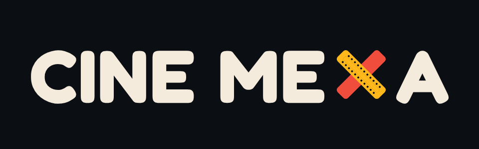

# Identidad visual

**Concepto**: un festival independiente, una revista cultural y una app contemporánea. Mexicana sin recurrir a símbolos turísticos ni patrones folclóricos: la mexicanidad está en el contenido, el tono y la tipografía cercana.

## Logotipo y símbolo

- **Wordmark**: `CINE MEXA` en Fredoka Bold, letras anchas y redondeadas.
- **La X**: dos tiras de película que se cruzan; la amarilla (proyector) pasa sobre la roja (en vivo) y lleva perforaciones en ambos bordes. Es el símbolo independiente de la marca.
- **Ícono de app**: la X sobre Cinema Black, sin texto. Fuente vectorial: `docs/brand/app-icon.svg`; PNG 1024 en `AppIcon.appiconset`.
- En SwiftUI: `XMark` y `Wordmark` (`DesignSystem/Brand.swift`), construidos con Shapes.

## Color

| Token | Hex | Uso |
|---|---|---|
| Cinema Black | `#0B0E13` | fondo principal |
| Deep Surface | `#141922` | tarjetas |
| Projector Yellow | `#FFB81C` | acciones, identidad, selección |
| Live Red | `#F04D3D` | estrenos, noticias, “en curso” |
| Paper Cream | `#F4EBDD` | texto principal; fondo de crítica y calendario |
| Electric Blue | `#65BACB` | metadatos, enlaces, categorías secundarias |
| Secondary Text | `#89929E` | texto secundario |

Contraste medido (WCAG) sobre Cinema Black: Cream 16.4:1, Yellow 11.2:1, Blue 8.7:1, Secondary 6.1:1, Red 5.4:1. Texto sobre rojo o amarillo siempre en tinta oscura (blanco sobre rojo sólo da 3.6:1). Sobre Paper Cream se usan `creamSecondary #5C5850` (6.0:1) y `creamRed #B8321F` (5.1:1). Ningún estado depende sólo del color: todos llevan texto y símbolo.

## Tipografía

- **Fredoka** (SemiBold/Bold): titulares, números de ranking, identidad. Carácter divertido y cercano con ejecución editorial.
- **SF Pro**: lectura, navegación y botones.
- **IBM Plex Mono**: fechas, cifras, puntuaciones, fuentes y etiquetas impresas.

Todas escalan con Dynamic Type.

## Recursos gráficos

Boletos con muescas (`TicketShape`) para festivales, convocatorias y funciones; etiquetas impresas (`TagLabel`); separadores punteados; titulares grandes y composiciones asimétricas. El placeholder de póster muestra título, año e “Imagen no disponible”.

## Movimiento

Transición zoom de póster a ficha (iOS 18), aparición progresiva de tarjetas en carruseles, rebote del símbolo al guardar, marcadores del mapa que crecen al aparecer, háptica discreta en selección y guardado. Todo se desactiva o simplifica con Reducir movimiento.
